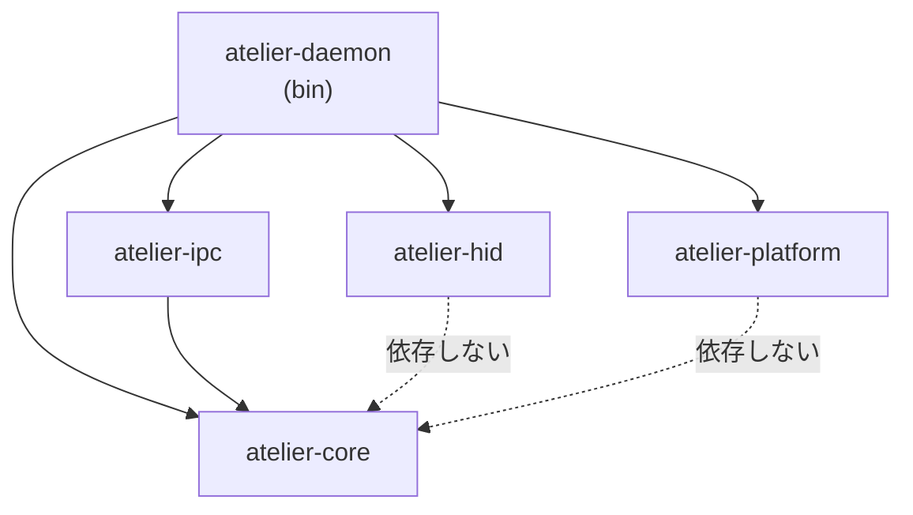

# ディレクトリ構成（Flutter GUI + Rust デーモン）

> 2026-10-12 起草。前提は仕様書 7-8「コンパニオンアプリ・ユースケース」の **7.2.1 2プロセス構成**。
> 常駐デーモン（Rust）と設定GUI（Flutter）を **1つのリポジトリ（モノレポ）** で管理する。

---

## 1. 方針

| # | 方針 | 理由 |
| --- | --- | --- |
| 1 | **Flutter プロジェクトはリポジトリ直下のまま**にし、Rust は `daemon/` に置く | `flutter run` / `flutter build` をルートでそのまま叩ける。既存の `linux/` `windows/` `lib/` を動かさずに済む |
| 2 | Rust は **Cargo workspace** にし、責務ごとに crate を分ける | VIA/Vial プロトコルやプロファイル解決を **HID・OS に触れずに単体テスト**したい。OS 依存は `atelier-platform` に、HID は `atelier-hid` に閉じ込める |
| 3 | GUI とデーモンで共有するもの（`vial.json`・IPC のメッセージ例）は **ファイルを1つだけ置き、両方から参照**する | 仕様書 7.2.2「配列図・マトリクス座標の二重管理を避ける」を GUI↔デーモン間でも守る |
| 4 | OS 差分は **デーモンの `atelier-platform` だけ**が持つ。`lib/` には `Platform.isWindows` 的な分岐を書かない | 仕様書 7.5「設定GUI は OS差分を一切持たない」 |
| 5 | 配布物（udev ルール・systemd unit・deb 定義）は `packaging/` にまとめる | 「デーモンと GUI を1つのパッケージに同梱」（7.2.2）するため、ビルド成果物を集める場所を1か所にする |

---

## 2. 全体像

```
atelier_studio/
├── README.md
├── pubspec.yaml               # Flutter（設定GUI）
├── analysis_options.yaml
├── lib/                       # 設定GUI（Flutter）… §4
├── test/                      # GUI のテスト
├── assets/
│   └── keyboard/
│       ├── vial.json          # ★ファームのリポジトリからコピー。GUI とデーモンの両方が読む
│       └── keycodes.json      # MODL/MODR・モジュール用カスタムキーコードの名前表
├── linux/                     # Flutter の Linux ランナー（生成物。基本触らない）
├── windows/                   # Flutter の Windows ランナー（生成物。基本触らない）
│
├── daemon/                    # 常駐デーモン（Rust）… §3
│   ├── Cargo.toml             # workspace
│   ├── Cargo.lock
│   ├── rust-toolchain.toml
│   └── crates/
│       ├── atelier-daemon/    # bin: エントリポイント・トレイ・配線
│       ├── atelier-core/      # lib: プロファイル / モジュール状態 / 割り当て解決（I/O なし）
│       ├── atelier-hid/       # lib: Raw HID・独自パケット・VIA/Vial プロトコル
│       ├── atelier-ipc/       # lib: GUI との JSON Lines over TCP
│       └── atelier-platform/  # lib: PlatformAdapter（Windows / Linux）
│
├── protocol/                  # GUI ↔ デーモンの取り決め … §5
│   ├── ipc.md                 # IPC メッセージ仕様（正）
│   └── fixtures/              # Rust・Dart 両方のテストが読むメッセージ例
│       ├── requests.jsonl
│       ├── responses.jsonl
│       └── events.jsonl
│
├── packaging/                 # 配布 … §6
│   ├── linux/
│   │   ├── 99-atelier.rules           # udev（hidraw を非root で開く）
│   │   ├── atelier-daemon.service     # systemd --user
│   │   └── deb/                       # control など
│   └── windows/
│       └── make_zip.ps1
│
├── scripts/
│   ├── sync_vial_json.sh      # ファームのリポジトリから vial.json をコピー
│   ├── build_all.sh           # cargo build --release + flutter build → dist/
│   └── reload_boxui.sh        # （既存。ルートから移動）
│
└── docs/
    ├── directory-structure.md # この文書
    └── ...
```

> `dist/`（パッケージ前の成果物置き場）と `daemon/target/` は `.gitignore` に追加する。

---

## 3. 常駐デーモン（`daemon/`）

### 3.1. crate の分け方と依存方向



- **`atelier-core` は I/O を一切持たない**（ファイル・HID・OS API を呼ばない）。純粋なロジックだけなので、テストが一番厚くなる場所。
- `atelier-hid` と `atelier-platform` は core を知らない「下回り」。core の型への変換は `atelier-daemon` 側で行う。
- `atelier-ipc` は GUI に見せる型（DTO）を持つ。core の型をそのまま serde で晒さず、**IPC 用の型に詰め替える**（core の内部変更が GUI の互換性を壊さないように）。

> crate が多すぎると感じる場合は、最初は `atelier-daemon` 1本に `mod` で同じ区切りを作り、**テストしづらくなった時点で crate に切り出す**のでもよい。区切り（モジュール境界）だけは最初から守る。

### 3.2. 各 crate の中身

```
daemon/crates/
├── atelier-daemon/
│   └── src/
│       ├── main.rs            # 引数解釈・ログ初期化・各スレッド起動
│       ├── app.rs             # 状態機械の本体。各スレッドからのメッセージを受けて振り分ける
│       ├── tray.rs            # tray-icon（★メインスレッドで回す）。レイヤー表示 / Vialモード表示
│       ├── notify.rs          # notify-rust による挿抜トースト
│       ├── vial_mode.rs       # Vialモードの出入り（0xD2 無効化 → HID クローズ / 再オープン → 読み直し）
│       ├── oled.rs            # OLED 送出。変化したときだけ送る・ロック中は止める
│       ├── gui_launcher.rs    # トレイ / トーストのクリックで GUI プロセスを起動
│       ├── diagnostics.rs     # 起動時チェック（HID が見えるか / pactl info / udev）
│       └── config_store.rs    # 設定ファイルの読み書き（§7 の実行時ディレクトリ）
│
├── atelier-core/
│   └── src/
│       ├── lib.rs
│       ├── bay.rs             # ベイ番号 0..=3（手前L/手前R/外側L/外側R）
│       ├── module.rs          # MODULE_ID とモジュールカタログ
│       ├── profile.rs         # ベイ×モジュール単位のプロファイル。アプリは「論理名」で持つ
│       ├── assignment.rs      # 割り当て（アプリ音量 / コマンド / なし）
│       ├── resolve.rs         # 入力イベント → 実行すべきアクションの解決
│       ├── keymap.rs          # レイヤー × (row, col) → keycode のモデル、差分計算
│       └── layer_state.rs     # 現在レイヤー / 固定中か（0xC3 由来）
│
├── atelier-hid/
│   └── src/
│       ├── lib.rs
│       ├── transport.rs       # hidapi で 0xFF60 を開く。読み取りは専用スレッドでブロッキング
│       ├── router.rs          # 受信の振り分け: 0xC0〜0xC3 → イベント / それ以外 → 待機中の要求への応答
│       ├── packet.rs          # 独自パケット（0xC0〜0xC3, 0xD0, 0xD2）のエンコード / デコード
│       ├── via.rs             # VIA dynamic keymap（0x04/0x05, 0x12/0x13, レイヤー数取得 …）
│       └── vial.rs            # Vial 固有（0xFE）
│
├── atelier-ipc/
│   └── src/
│       ├── lib.rs
│       ├── message.rs         # Request / Response / Event（serde, JSON Lines）
│       ├── server.rs          # 127.0.0.1 の TCP。1行1メッセージ
│       └── auth.rs            # ポート番号 + トークンを接続ファイルに書く / 照合する
│
└── atelier-platform/
    └── src/
        ├── lib.rs             # trait PlatformAdapter と、cfg で実装を選ぶ関数
        ├── windows/
        │   ├── mod.rs
        │   ├── audio.rs       # Core Audio のセッションボリューム（windows クレート）
        │   ├── sysinfo.rs     # CPU 等
        │   └── autostart.rs   # スタートアップ登録
        ├── linux/
        │   ├── mod.rs
        │   ├── pactl.rs       # pactl list sink-inputs / set-sink-input-volume
        │   ├── sysinfo.rs     # /proc
        │   └── autostart.rs   # systemd --user
        ├── script.rs          # std::process::Command で起動して待たずに切り離す（両OS共通部分）
        └── mock.rs            # テスト用のダミー Adapter（#[cfg(test)] / feature = "mock"）
```

### 3.3. スレッドと配置の対応

仕様書 7.2.2「トレイのイベントループはメインスレッドで回し、HID受信・IPC は別スレッドからチャネルで渡す」をそのままファイルに対応させる。

| スレッド | 置き場所 | 役割 |
| --- | --- | --- |
| メイン | `atelier-daemon/tray.rs` + `app.rs` | トレイのイベントループ。チャネルから届いたメッセージで状態を更新 |
| HID 受信 | `atelier-hid/transport.rs` | ブロッキング読み取り（ポーリングしない）。`router.rs` で振り分けてチャネルへ |
| IPC | `atelier-ipc/server.rs` | GUI からの接続を受ける。GUI が居ないときは accept で寝ているだけ |
| スクリプト | `atelier-platform/script.rs` | 起動したら待たない（スレッドを持ち続けない） |

> **`router.rs` が肝。** 同じ口に「VIA の応答」と「本機の非同期通知」が混ざって届くので（仕様書 7.4.1 (b)）、先頭バイトで振り分ける処理をデーモン内で1か所にまとめる。ここを散らすと、自分のアプリ内で Vial と同じ取り違えを起こす。

---

## 4. 設定GUI（`lib/`）

画面（仕様書 7.6）ごとに `features/` を切る **feature-first** 構成にする。GUI は IPC しか話さないので、**HID・OS を触るコードは `lib/` に1行も無い**のが正しい状態。

```
lib/
├── main.dart                  # theme 初期化・runApp(StudioApp()) だけ
├── app/
│   ├── studio_app.dart        # StudioApp（WidgetsApp）
│   ├── router.dart            # 画面遷移の定義
│   └── shell.dart             # サイドバー＋コンテンツ領域の外枠
│
├── core/                      # 画面に依存しない土台
│   ├── ipc/
│   │   ├── connection_file.dart   # 接続ファイルからポート番号とトークンを読む
│   │   ├── daemon_client.dart     # TCP + JSON Lines。要求IDで応答を突き合わせる
│   │   ├── daemon_launcher.dart   # 繋がらなければデーモンを起動して繋ぎ直す
│   │   └── messages.dart          # Request / Response / Event（protocol/ipc.md と対応）
│   └── keyboard/
│       ├── vial_layout.dart       # assets/keyboard/vial.json の配列図（KLE）を読む
│       └── keycodes.dart          # キーコード ↔ 表示名（MODL/MODR 等を含む）
│
├── data/                      # デーモンへの問い合わせをまとめる層（画面からは直接 IPC を叩かない）
│   ├── keymap_repository.dart
│   ├── profile_repository.dart
│   ├── module_repository.dart     # ベイの装着状態・ライブ入力値（イベント購読）
│   ├── command_repository.dart
│   └── diagnostics_repository.dart
│
├── features/
│   ├── home/                  # ① 本体の図＋4ベイ＋現在レイヤー
│   ├── module_detail/         # モジュール詳細（ライブ表示）
│   ├── profile/               # ② 一覧 / プロファイル編集
│   │   └── assignment_dialog.dart   # 割り当てダイアログ（module_detail からも使う）
│   ├── keymap/                # ③ レイヤー × キー編集
│   │   └── keycode_picker.dart
│   ├── command/               # ④ カスタムキーコード → スクリプト
│   ├── oled/                  # ⑤（未決12: module_detail に畳む可能性あり）
│   └── settings/              # ⑥ 自動起動 / バージョン
│       └── diagnostics/       # 診断（デーモンに結果を問い合わせて表示）
│
└── shared/
    └── widgets/               # box_ui の上に作るアプリ固有の部品（ベイ図・キー1個 など）
```

各 `features/xxx/` の中は次の形に揃える。

```
features/keymap/
├── keymap_page.dart           # 画面
├── keymap_controller.dart     # 画面の状態（読み込み中 / Vialモード中で読み取り専用 …）
└── widgets/                   # この画面でしか使わない部品
```

- **割り当てダイアログは `profile/` に置き、`module_detail/` から import する**（仕様書 7.6「ダイアログ自体は共通」）。2か所から使われ始めたら `shared/` に上げる。
- **Vialモード中の読み取り専用表示**はデーモンからのイベントで切り替わるので、`data/` 層で状態として持ち、各 controller が見る。
- 状態管理のライブラリ（Riverpod / 素の `ChangeNotifier` など）は未決。上の `controller` は役割名で、実装手段は問わない。

### 4.1. テスト

```
test/
├── core/ipc/messages_test.dart   # protocol/fixtures/*.jsonl を読んでデコードできるか
├── core/keyboard/vial_layout_test.dart
└── features/...
```

---

## 5. GUI ↔ デーモンの取り決め（`protocol/`）

Rust（serde）と Dart の **2か所に同じメッセージ型を書く**ことになるので、ずれを検出する仕組みを置く。

| ファイル | 役割 |
| --- | --- |
| `protocol/ipc.md` | メッセージ仕様の**正**。要求・応答・イベントの一覧、エラーコード、バージョン |
| `protocol/fixtures/*.jsonl` | 1行1メッセージの実例。**Rust の `atelier-ipc` のテストと Dart の `messages_test.dart` の両方が読み**、「デコード → エンコードで元に戻るか」を確かめる |

- 仕様を変えたら **`ipc.md` → fixtures → Rust → Dart** の順に直す。fixtures を直した時点で片方のテストが落ちるので、直し忘れに気づける。
- 型が増えて手書きがつらくなったら、JSON Schema から両言語のコードを生成する案に移る（今はやらない）。
- 接続確立時に **プロトコルバージョン**を交換し、合わなければ GUI 側で「デーモンを更新してください」と出す（同梱配布なので通常は一致する。開発中のずれ対策）。

---

## 6. 共有アセットと配布

### 6.1. `vial.json` の扱い

- 正はファームのリポジトリ。`scripts/sync_vial_json.sh` で **`assets/keyboard/vial.json` にコピーしてコミット**する（ビルド時にファームのリポジトリが無くても通るように）。
- GUI: `pubspec.yaml` の `flutter: assets:` に登録して読む（配列図の描画）。
- デーモン: `include_str!` で埋め込む（マトリクスの行数・列数を、dynamic keymap のバッファ読み出しに使う）。
  ```rust
  // atelier-daemon/src/...
  const VIAL_JSON: &str = include_str!("../../../../assets/keyboard/vial.json");
  ```
- これで **1ファイルを GUI とデーモンが共有**し、配列の定義を二重に持たない。

### 6.2. `packaging/`

| ファイル | 内容 |
| --- | --- |
| `linux/99-atelier.rules` | `hidraw` を非root で開くための udev ルール（Vial と同じ VID/PID） |
| `linux/atelier-daemon.service` | `systemd --user` の unit。**デーモンだけ**を自動起動 |
| `linux/deb/` | `.deb` の control 等。`/usr/lib/atelier/` にデーモンと GUI のバンドルを入れる |
| `windows/make_zip.ps1` | デーモンの exe と GUI の Release フォルダを1つの zip に |

- GUI は**デーモンと同じディレクトリ**にデーモンのバイナリがある前提で起動する（`daemon_launcher.dart`）。開発中は環境変数（例: `ATELIER_DAEMON_PATH`）で `daemon/target/debug/atelier-daemon` を指す。

---

## 7. 実行時のファイル配置（参考）

リポジトリではなく、インストール後にユーザー環境にできるもの。**書き込むのはデーモンだけ**で、GUI は IPC 経由で編集を依頼する（スクリプトの実行やプロファイル解決をするのがデーモンなので、正をデーモン側に置く）。

```
~/.config/atelier/              # Linux（Windows は %APPDATA%\atelier\）
├── daemon.json                 # ポート番号 + 接続トークン（GUI が読む唯一のファイル）
├── profiles/
│   └── <bay>-<module_id>.json  # ベイ×モジュール単位
├── commands.json               # カスタムキーコード → スクリプト
├── oled.json                   # 表示項目
└── logs/
```

- パスは `directories` クレートで OS ごとに解決し、`atelier-daemon/config_store.rs` に閉じ込める。
- `daemon.json` は他ユーザーから読めない権限で作る（トークンを守るため）。
- キーマップはここに無い（正はキーボードの EEPROM。仕様書 6.3）。インポート/エクスポートのファイルにだけ含める。

---

## 8. 開発時の動かし方（想定）

```sh
# デーモン（ターミナル1）
cd daemon && cargo run -p atelier-daemon

# GUI（ターミナル2）
ATELIER_DAEMON_PATH=daemon/target/debug/atelier-daemon flutter run -d linux

# テスト
cd daemon && cargo test --workspace
flutter test
```

---

## 9. 今の構成からの移行

1. `daemon/` を作り、Cargo workspace と空の crate を置く
2. `.gitignore` に `daemon/target/` と `dist/` を追加
3. `reload_boxui.sh` を `scripts/` へ移動
4. `lib/main.dart` の `StudioApp` を `lib/app/studio_app.dart` へ、`HomePage` を `lib/features/home/home_page.dart` へ分割
5. `assets/keyboard/vial.json` を配置し `pubspec.yaml` に登録
6. `protocol/ipc.md` に最初のメッセージ（接続・バージョン交換・診断結果取得）だけ書き、fixtures と両側のテストを通す

---

## 10. 未決事項（この文書に関係するもの）

| # | 内容 |
| --- | --- |
| A | crate を最初から5本に分けるか、1本で `mod` 分割から始めるか（§3.1） |
| B | Flutter の状態管理ライブラリ（§4） |
| C | IPC 型をコード生成に移す時期（§5） |
| D | OLED 画面を独立させるか（仕様書 未決12）→ `features/oled/` の有無 |
| E | `keycodes.json` の正をどこに置くか（ファームの `keymap.c` のカスタムキーコード定義と揃える必要がある） |
