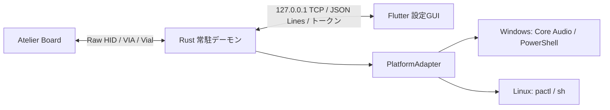

# Atelier Studio 仕様書

作成日: 2026-10-18  
対象: `atelier_studio`（Atelier Board のホスト側コンパニオンアプリ）  
状態: 設計・初期開発。実装済みと明記したものを除き、本文は今後満たすべき要件です。

## 1. 目的と上位仕様

Atelier Board は、4つのベイにモジュールを挿し替えて操作を増やす自作キーボードです。Atelier Studio はキーマップとホスト側機能を Windows / Linux で設定・実行します。利用者は開発者本人を前提とし、量産・頒布向けの互換保証は対象外です。

同ディレクトリの分割仕様も参照し、本リポジトリの責務を整理しています。

| 分割仕様書（共通接頭辞「モジュール拡張型自作キーボード 仕様書」を省略） | 根拠 |
| --- | --- |
| `7-8 コンパニオンアプリ・ユースケース.md` | §7: 構成・機能・通信・画面、§8: ユースケース |
| `5-6 通信プロトコル・ファームウェア.md` | §6.2: レイヤー、§6.3: キーマップの正と非破壊性 |
| `9-11 開発フェーズ・非機能要件・未決事項.md` | §9: P4 / P5、§10: 非機能要件、§11: 未決12〜15 |
| `12 確定事項ログ.md` | 2026-10-05: プロファイル単位、10-06: キーリマップ、10-12: 2プロセス化・Vialモード |

要件の正は上位仕様、IPC 契約の正は [protocol/ipc.md](../protocol/ipc.md)、配置設計は [directory-structure.md](directory-structure.md)です。資料間の不一致は §12 に記録し、未決事項を本書だけで確定させません。

## 2. スコープ

| 含む | 対象外 |
| --- | --- |
| Windows / Linux の設定GUI・常駐デーモン | Web版・モバイル版・macOS 対応 |
| VIA/Vial 経由のキーリマップ | Vial 全機能の再実装 |
| モジュール状態・プロファイル・音量・コマンド・OLED | PCB・ケース・回路・QMK ファーム自体の実装 |
| トレイ・通知・診断・自動起動・配布 | ファーム書き込み、マクロ録音、Tap Dance / Combo / Key Override の編集 |

初期モジュールは M1 Encoder、M2 Trackball、M3 Fader、M4 OLED4Key です。通常の入力とモジュールレイヤー制御はファーム側の責務とし、本アプリの常駐を通常のキー入力の前提にしません。

## 3. 現在の実装状況

2026-10-18 時点のソース確認結果です。

| 区分 | 内容 |
| --- | --- |
| GUI | `lib/main.dart` の起動・テーマ・ウィンドウ設定、`lib/home_page/home_page.dart` の仮画面、`lib/widgets/` のタイトルバーとぼかし用部品 |
| ウィンドウ | 初期・最小 720 × 500、中央配置、ドラッグ・最小化・最大化・終了用の部品 |
| テーマ | `box_ui`、Black Ops One / Kosugi Maru |
| ネイティブ | Linux / Windows ランナーに `bitsdojo_window` 設定あり |
| 設計・配布準備 | 構成案、IPC v1 と fixtures、udev・systemd・deb 定義、同梱ビルドスクリプト |
| 未実装 | Rust デーモン、IPC、HID、機能画面、永続化、テスト |

`daemon/`、`assets/keyboard/vial.json`、`assets/keyboard/keycodes.json` は未配置、`test/` は空です。Riverpod 等の依存はありますが、業務状態管理は未実装です。`HELLO` 画面は完成したホーム画面ではありません。

## 4. アーキテクチャ



- デーモンはログイン中に常駐し、HID を開く唯一のプロセスです。VIA/Vial、イベント受信、割り当て解決、音量・コマンド、OLED、トレイ・通知を担当します。
- GUI は設定時だけ起動し、閉じれば終了します。IPC で依頼し、HID を直接扱いません。音声制御等の OS 差分を画面・業務ロジックに持ち込みません。
- OS 差分はデーモン内の `PlatformAdapter` に閉じ込めます。ネイティブランナーのウィンドウ設定は各プラットフォーム側に置きます。
- GUI は接続できなければデーモンを起動して再接続し、失敗が続けば診断の案内を表示する設計です。この起動処理は未実装です。

### コードの境界（予定）

| 領域 | 責務 |
| --- | --- |
| `atelier-daemon` | 起動、状態機械、各層の配線、トレイ・通知、設定ファイル I/O |
| `atelier-core` | モジュール・プロファイル・差分計算・割り当て解決。I/O を持たない |
| `atelier-hid` | HID、独自パケット、VIA/Vial、通知と応答の振り分け |
| `atelier-ipc` | TCP、認証、IPC 用 DTO。core の内部型を直接公開しない |
| `atelier-platform` | OS Adapter とテスト用 mock |
| GUI `core/`・`data/`・`features/` | IPC 基盤、問い合わせの集約、機能単位の画面と状態管理 |

トレイはメインスレッド、HID 受信と IPC は別スレッドとし、チャネルで状態機械に渡します。最初から crate 分割するか、単一 crate のモジュールから始めるかは未決です。詳細な予定配置は[構成設計](directory-structure.md)を参照してください。

## 5. 機能要件

### 5.1. モジュール・プロファイル

設計上限は同時4基です。通常の2基運用をアプリの制限にしません。

| ベイ番号 | 位置 |
| --- | --- |
| 0 | 手前L |
| 1 | 手前R |
| 2 | 外側L |
| 3 | 外側R |

- 装着状態、モジュール ID、入力値を表示し、挿抜を通知します。通知から該当モジュール詳細を開きます。
- プロファイルは **ベイ × モジュール種別**ごとに1つです。グローバルな「配信用／作業用」セットやトレイでの手動切替は持ちません。
- 差し替えで設定を選び、初めての組み合わせは割り当てなしで始めます。
- 操作子には「アプリ音量／コマンド／なし」を割り当てます。アプリは実行中の音声セッションから選び、設定には OS 非依存の論理名を保存します。
- 一覧・編集・複製・インポート・エクスポートを提供します。入出力ファイルにキーマップも含めますが、具体的な形式は未定義です。

### 5.2. キーリマップ

- `vial.json` の配列図とマトリクス座標でレイヤーごとのキーを表示・編集します。
- 基本キー・モディファイア・レイヤーキー、`MODL` / `MODR`・モジュール用カスタムキーコードを名前付きで選択できます。
- レイヤー複製・入れ替え、既定キーマップへのリセット、ファイル入出力を対象とします。
- 唯一の正はキーボードの EEPROM です。ホスト側の保存データを正として上書きせず、読み直してから書きます。画面表示時・フォーカス復帰時・Vialモード解除時に再取得する方針です。
- 未知のキーコードや未対応機能は読み取り専用で保持し、Tap Dance・Combo 等を破壊しません。通信には VIA/Vial を使い、独自形式を作りません。
- 即時書き込みか「適用」での一括書き込みかは未決13です。上位仕様の即時反映の記載を、そのまま確定とは扱いません。

### 5.3. ホスト側機能

| 機能 | 要件 |
| --- | --- |
| アプリ別音量 | フェーダー値を対象セッションへ反映。Windows は Core Audio、Linux は `pactl` |
| コマンド | カスタムキーコードにスクリプトを登録し、テスト実行を提供。PowerShell / sh を想定。実行完了待ちでデーモンを止めない |
| OLED | CPU・時刻・再生中の曲等を生成し、項目選択・プレビューを提供。変化時のみ送出、時刻は分単位、ロック・スリープ中は停止 |
| レイヤー | 現在レイヤーと固定中かをトレイ等で表示。正はファームの通知 |
| 自動起動 | デーモンのみ。Windows はスタートアップ、Linux は `systemd --user` |

### 5.4. Vialモード

Vial 公式アプリをフォールバックとして使うため、デーモンのトレイから手動で切り替えます。

| 状態 | 動作 |
| --- | --- |
| 通常 | デーモンが HID を開き、通知を購読して送受信 |
| 移行時 | `0xD2` で通知を無効化し、PC→KB の送信を停止して HID を閉じる |
| モード中 | 音量・コマンド・レイヤー更新を停止。トレイにモードを表示、GUI のキーマップは読み取り専用 |
| 解除時 | HID を開き直し、通知を有効化し、キーマップを再取得。GUI も再取得 |

通知停止だけでは OLED 更新等の応答が Vial に混入するため、送信停止とハンドル解放も必須です。自動切替は未決15です。

## 6. 画面・導線（設計案）

| 画面 | 内容・遷移 |
| --- | --- |
| ホーム | 本体図、4ベイ、現在レイヤー。ベイから詳細へ |
| モジュール詳細 | ID・ライブ入力値。割り当て・該当キーマップへ |
| プロファイル | 一覧・複製・入出力。編集から共通の割り当てダイアログへ |
| キーマップ | レイヤー・配列図・キーコード選択・読み取り専用状態 |
| コマンド | 一覧・編集・テスト実行 |
| OLED | 表示項目・プレビュー。独立画面にするかは未決12 |
| 設定・診断 | 自動起動・バージョン・HID / 音声 / udev の診断 |

入口はトレイのクリック／「ウィンドウを開く」と挿抜通知です。GUI 単独起動にも対応する方針です。

## 7. 通信

### GUI ↔ デーモン

詳細は [IPC メッセージ仕様](../protocol/ipc.md)を正とします。

- `127.0.0.1` の空き TCP ポート、UTF-8 JSON Lines（1行1メッセージ）を使用します。
- デーモンがポート・トークン・バージョン・PID を `daemon.json` に出力します。トークンは起動ごとのランダム32バイトの hex、Linux のファイル権限は `0600` です。
- 最初の要求は `hello`。不正トークンは `unauthorized`、バージョン不一致は `version_mismatch` として切断します。現在の契約バージョンは **1** です。
- 要求は整数 `id`・`method`・`params`、応答は同じ `id` と `result` または `error`、イベントは `event`・`data` を持ちます。順序でなく `id` で対応付け、未知のキーは無視します。
- 定義済み要求は `hello` / `diagnostics.get` / `vial_mode.get`、イベントは `vial_mode.changed` / `diagnostics.changed` です。**実装はまだありません。**
- キーマップ等の API は未定義です。仕様変更は `ipc.md` → fixtures → Rust → Dart の順で反映し、例を両言語のテストで共有します。

### デーモン ↔ キーボード

Usage Page **`0xFF60`** の Raw HID を使用し、独自パケットは **32バイト固定**です。上位 §7.4 のヘッダー案は `[0] コマンドID / [1] ベイ番号 / [2] MODULE_ID / [3..] ペイロード` です。

| ID | 方向 | 用途 |
| --- | --- | --- |
| `0xC0` | KB→PC | 挿入通知 |
| `0xC1` | KB→PC | 抜去通知 |
| `0xC2` | KB→PC | 入力イベント |
| `0xC3` | KB→PC | レイヤー・固定状態 |
| `0xD0` | PC→KB | OLED 更新 |
| `0xD2` | PC→KB | 通知の有効化・無効化（既定は無効） |

`0xD1` は LED 制御廃止による欠番です。キーマップは VIA dynamic keymap（`0x04` / `0x05`、バッファ版 `0x12` / `0x13` 等）と Vial `0xFE` 系を使います。通知と待機中の要求への応答はデーモン内の1か所で振り分けます。

各ペイロード・値域、レイヤー通知でのベイ番号等の扱い、通知購読の切断検出はヘッダー案だけでは確定できず、ファームと取り決める必要があります。

## 8. データ・共有アセット

| データ | 正・方針 |
| --- | --- |
| キーマップ | キーボード EEPROM。恒久キャッシュを正にしない。入出力ファイルには含める |
| `vial.json` | ファーム側が正。GUI・デーモンで同じ配列定義を共有 |
| `keycodes.json` | 固有コードの名前表。ファームと整合させる必要があり、正の置き場所は未決 |
| プロファイル | ベイ×モジュール。対象アプリは OS 非依存の論理名 |
| コマンド・OLED | デーモンが保存し、GUI は IPC で編集依頼 |

予定する設定先は Linux `~/.config/atelier/`、Windows `%APPDATA%/atelier/` です。

```text
atelier/
├── daemon.json
├── profiles/<bay>-<module_id>.json
├── commands.json
├── oled.json
└── logs/
```

GUI が直接読む設定ファイルは `daemon.json` のみです。永続化処理はまだありません。

構成設計では `vial.json` を `assets/keyboard/` に同期・コミットし、GUI は Flutter assets、デーモンは埋め込みで参照する予定です。ファイル・同期処理・assets 登録は未整備です。

## 9. 診断・非機能要件

- 起動時にデーモンが HID・音声・udev を診断し、失敗はトレイ警告・通知と GUI の診断画面で示します。
- HID の未接続・権限不足・Vialモードでの解放を区別します。Linux の音声は `pactl info` で確認し、コマンド不在と互換サービス不通を区別します。Windows の udev は `not_applicable` です。
- 常駐はデーモンのみ。HID はブロッキング読み取りとし、待機のためのポーリングを作りません。上位仕様の目安は待機時メモリ十数MB以内・CPU ほぼ0%です。現在の測定値ではありません。
- GUI 終了・IPC 切断でデーモンは終了しません。デーモンやモジュールの不具合でも通常のキー入力はファーム側で継続する設計です。
- 両OSで同一機能・同一プロファイルを利用でき、未対応のキー設定を壊さないことを必須とします。
- キー入力約5ms・モジュール入力約20msは上位のシステム全体の目標です。IPC や `pactl` 単体の保証値には読み替えず、実機を含めて評価します。

## 10. 開発・配布

現行の GUI 起動手順と `box_ui` のローカル依存は [README](../README.md)を参照してください。

| 対象 | 配布設計 | 現在の制約 |
| --- | --- | --- |
| Linux | GUI とデーモンを同じ場所に置き、deb に udev・systemd user unit を同梱 | `daemon/` 不在、VID/PID 仮値 `feed:0000`、Maintainer 未設定 |
| Windows | GUI Release 一式と `atelier-daemon.exe` を zip に同梱 | `daemon/` 不在、ローカル `box_ui` パスの変更が必要 |

自動起動登録はデーモンだけです。構成設計の `ATELIER_DAEMON_PATH` は案であり、現行 GUI に対応処理はありません。

## 11. 受け入れ条件・検証方針

以下は検証計画であり、実行済みテストではありません。

| 対象 | 受け入れ条件 |
| --- | --- |
| プロセス分離 | GUI を閉じても常駐機能が継続し、再起動時に再接続できる |
| IPC | Rust / Dart で fixtures が往復変換できる。不正認証・バージョン不一致を拒否し、イベントと応答を混同しない |
| 4ベイ | 挿抜・設定を独立に扱い、3基目・4基目を制限しない。初回は割り当てなし |
| キーリマップ | 書き換えが打鍵に反映し、Vial でも一致。未知キー・高度設定を保持 |
| Vialモード | 通知・送信が止まり HID を解放。GUI は読み取り専用、解除後に変更を再取得 |
| OS Adapter | 同じ論理名の設定から両OSで対象アプリの音量を操作可能 |
| コマンド・OLED | 実行がデーモンを止めず、OLED は変化時のみ更新、ロック・スリープ中は停止 |
| 診断 | 未接続・権限不足・音声不通を再現し、原因に合う表示が出る |
| 常駐負荷・配布 | 待機負荷を測定し、両OSで配布物の起動・自動起動・GUI 起動終了を確認 |

割り当て解決・差分計算は core 単体テスト、メッセージは共有 fixtures、画面は Widget テスト、HID / OS / Vial 互換は結合・実機検証で確認します。上位 **P4** の完了条件は両OSの Raw HID・アプリ別音量・キーリマップ・Vial 整合、**P5** は M4 の OLED を含む仕上げです。現時点では完了を確認していません。

## 12. 未決事項・資料間の差分

| 項目 | 扱い |
| --- | --- |
| 上位・未決12 | OLED を独立画面にするか M4 詳細に含めるか未決 |
| 上位・未決13 | 即時書き込み／適用ボタンが未決。上位の即時反映の表記を確定とみなさない |
| 上位・未決14 / 15 | 手動 Vialモードと解除時の再取得は決定済み。入れ忘れ対策・自動化は未決 |
| `vial.json` 同期時期 | 上位はビルド時コピー、構成設計は事前同期・コミット。正をファームとする点は共通。同期時期は要整合 |
| crate・状態管理 | 分割粒度は未決。Riverpod 依存はあるが、画面・状態管理の標準構成は未整備 |
| キーコード名表 | `keycodes.json` の正とファームとの同期方法が未決 |
| 通信・保存形式 | HID ペイロード、未定義 IPC、設定・入出力スキーマ、再接続・タイムアウト等は要定義 |
| 実機・配布情報 | VID/PID、`vial.json` コピー元、Rust toolchain、配布メタデータを実装前に確定 |

決定時は上位仕様・通信仕様・構成設計と本書を合わせて更新し、実装状況は README と §3 に反映します。
