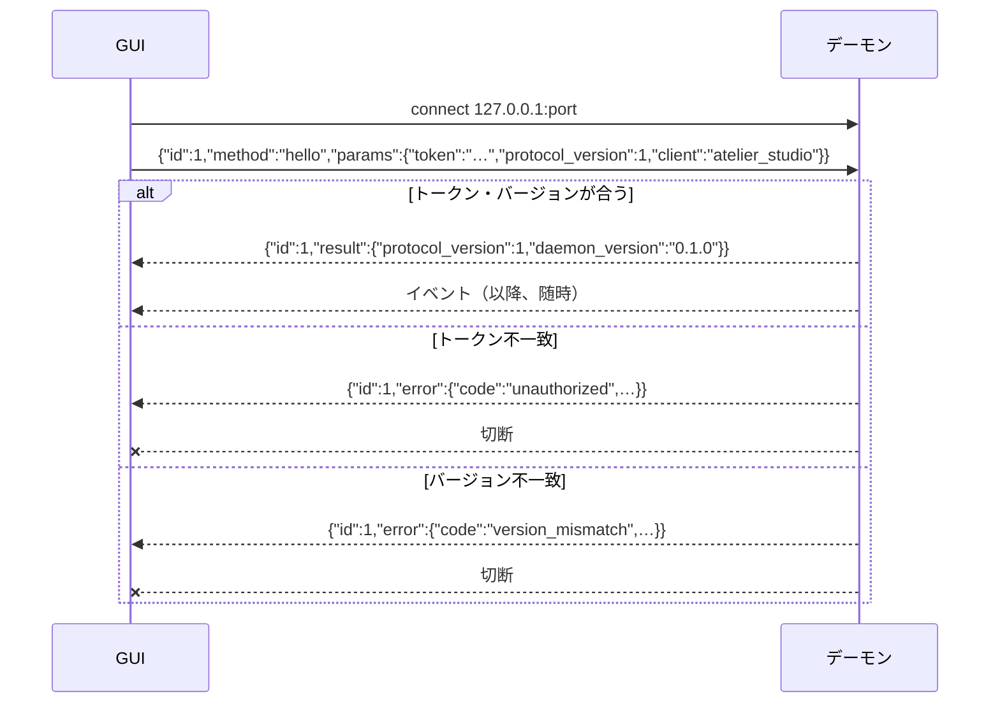

# IPC メッセージ仕様（GUI ↔ デーモン）

> この文書が**正**。変更するときは **この文書 → `fixtures/` → Rust（`atelier-ipc`）→ Dart（`lib/core/ipc/messages.dart`）** の順に直す。
> 背景は仕様書 7.2.2「GUI ↔ デーモン」と `docs/directory-structure.md` §5。

- プロトコルバージョン: **1**
- 状態: 骨組みのみ（接続・診断・Vialモード）。残りは §6 の TODO。

---

## 1. トランスポート

| 項目 | 内容 |
| --- | --- |
| 経路 | `127.0.0.1` の TCP。デーモンが listen、GUI が connect |
| 形式 | **JSON Lines**（UTF-8、1行に1メッセージ、改行は `\n`） |
| 接続数 | GUI は1プロセスなので通常1本。デーモンは複数接続を拒否しない |
| 寿命 | GUI が閉じたら切断。デーモンは切断を異常扱いしない |

### 1.1. 接続ファイル（`daemon.json`）

デーモンは起動時に空きポートで listen し、ポート番号とトークンをユーザー設定ディレクトリに書く。GUI はこれを読んで接続する。

- 置き場所: Linux `~/.config/atelier/daemon.json` / Windows `%APPDATA%\atelier\daemon.json`
- 権限: 本人だけが読める（Linux は `0600`）

```json
{"protocol_version": 1, "port": 51234, "token": "3f9c…（ランダム32バイトの hex）", "pid": 4321}
```

| キー | 型 | 内容 |
| --- | --- | --- |
| `protocol_version` | int | デーモンが話すバージョン |
| `port` | int | listen 中のポート |
| `token` | string | 接続トークン。デーモン起動ごとに作り直す |
| `pid` | int | デーモンのプロセスID（GUI が「ファイルはあるが死んでいる」を見分ける用） |

---

## 2. メッセージの種類

メッセージは3種類。キーの有無で見分ける。

| 種類 | 向き | 見分け方 |
| --- | --- | --- |
| 要求 (request) | GUI → デーモン | `id` と `method` がある |
| 応答 (response) | デーモン → GUI | `id` があり、`result` か `error` のどちらか一方がある |
| イベント (event) | デーモン → GUI | `event` がある（`id` は無い） |

```jsonc
// 要求
{"id": 1, "method": "diagnostics.get", "params": {}}
// 応答（成功）
{"id": 1, "result": { … }}
// 応答（失敗）
{"id": 1, "error": {"code": "unknown_method", "message": "…"}}
// イベント
{"event": "vial_mode.changed", "data": {"active": true}}
```

- `id` は GUI が振る整数。接続ごとに1から増やす。応答は同じ `id` で返る。**応答の順序は要求の順序と一致するとは限らない**。
- `params` は省略不可（無ければ `{}`）。
- 未知のキーは**無視する**（前方互換のため。両側とも）。

---

## 3. 接続手順

1. GUI が `daemon.json` を読んで接続する
2. **最初の要求は必ず `hello`**。それ以外が来たらデーモンは `unauthorized` を返して切断する
3. `hello` が成功したら、以降の要求とイベントの受信が始まる



---

## 4. 要求一覧

### 4.1. `hello`

接続の認証とバージョン確認。

| params | 型 | 内容 |
| --- | --- | --- |
| `token` | string | `daemon.json` の `token` |
| `protocol_version` | int | GUI が話すバージョン |
| `client` | string | クライアント名（ログ用） |

| result | 型 | 内容 |
| --- | --- | --- |
| `protocol_version` | int | デーモンが話すバージョン |
| `daemon_version` | string | デーモンのバージョン（表示用） |

エラー: `unauthorized` / `version_mismatch`

### 4.2. `diagnostics.get`

デーモンが持っている最新の診断結果を返す（仕様書 7.6「診断」。HID を開くのはデーモンだけなので GUI は問い合わせるだけ）。

params: なし

| result | 型 | 内容 |
| --- | --- | --- |
| `hid` | Check | キーボード（Raw HID `0xFF60`）が開けるか |
| `audio` | Check | 音量制御が使えるか（Linux: `pactl info`、Windows: Core Audio） |
| `udev` | Check | udev ルールが入っているか（Windows では `not_applicable`） |

**Check**

| キー | 型 | 内容 |
| --- | --- | --- |
| `status` | string | `ok` / `error` / `not_applicable` |
| `code` | string? | `status` が `error` のときの理由（下表） |
| `message` | string? | 人が読む説明（GUI はそのまま表示してよい） |

| 項目 | `code` の値 |
| --- | --- |
| `hid` | `not_found`（見えない）/ `permission_denied`（見えるが開けない）/ `closed_by_vial_mode`（Vialモード中で閉じている） |
| `audio` | `pactl_not_found` / `pulse_unavailable`（pipewire-pulse 等が動いていない）/ `core_audio_failed` |
| `udev` | `rule_missing` |

### 4.3. `vial_mode.get`

Vialモード中かを返す（仕様書 7.4.1「Vialモード」）。GUI はキーマップ画面を読み取り専用にするかの判断に使う。

params: なし

| result | 型 | 内容 |
| --- | --- | --- |
| `active` | bool | Vialモード中なら `true` |

> Vialモードの切り替えはトレイメニューからだけ行う（GUI からは切り替えない）。

---

## 5. イベント一覧

### 5.1. `vial_mode.changed`

Vialモードに入った / 抜けたとき。

| data | 型 | 内容 |
| --- | --- | --- |
| `active` | bool | 新しい状態 |

> 抜けたとき（`active: false`）はデーモンがキーマップを読み直している。GUI は表示中のキーマップを取り直すこと。

### 5.2. `diagnostics.changed`

診断結果が変わったとき（キーボードが抜けた / 挿さった、など）。`data` は `diagnostics.get` の `result` と同じ形。

---

## 6. エラーコード

| `code` | 意味 |
| --- | --- |
| `unauthorized` | `hello` 前の要求、またはトークン不一致。デーモンは切断する |
| `version_mismatch` | プロトコルバージョン不一致。デーモンは切断する |
| `unknown_method` | 知らない `method` |
| `invalid_params` | `params` の形が違う |
| `vial_mode_active` | Vialモード中のため実行できない（キーマップ書き込みなど。§7 で使う予定） |
| `internal` | デーモン内部のエラー |

---

## 7. TODO（後で足す）

- [ ] キーマップ: レイヤー数 / 全体読み出し / 1キー書き込み / リセット（VIA dynamic keymap）
- [ ] モジュール: 4ベイの装着状態取得、挿抜イベント、入力値のライブイベント（購読制にするか）
- [ ] レイヤー状態イベント（`0xC3` 由来）
- [ ] プロファイル: 一覧 / 取得 / 保存 / 複製 / インポート・エクスポート
- [ ] 実行中の音声セッション一覧（割り当てダイアログ用）
- [ ] コマンド: 一覧 / 保存 / テスト実行
- [ ] OLED: 設定の取得 / 保存
- [ ] 自動起動の取得 / 設定

---

## 8. fixtures

`fixtures/` の各ファイルは1行1メッセージ。Rust と Dart のテストは**全行を「デコード → エンコード → 再デコード」して同じ値に戻るか**を確かめる。

| ファイル | 中身 |
| --- | --- |
| `requests.jsonl` | §4 の要求の例 |
| `responses.jsonl` | §4 の応答（成功・失敗）の例 |
| `events.jsonl` | §5 のイベントの例 |

> JSON Lines にコメントは書けないので、各行の意味はこの文書の該当節を見ること。
